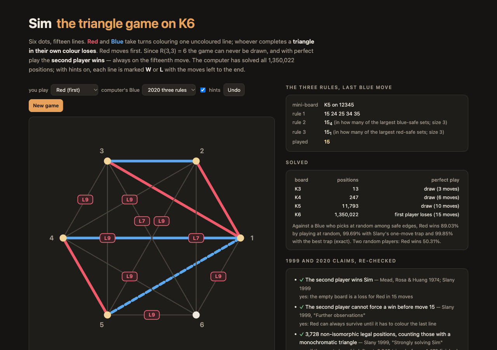

# Sim — the triangle game on K6 against a perfect player, and the 1999 and 2020 papers rechecked



**Sim** in the browser, against a perfect player. Six dots, all fifteen lines between them. Red and Blue take turns
colouring one uncoloured line; whoever completes a triangle in their own colour loses. Red moves first. Because the
Ramsey number R(3,3) is 6, every red/blue colouring of K6 contains a one-colour triangle, so the game cannot be drawn.
With perfect play the second player wins.

The game is Gustavus Simmons' (1969). Mead, Rosa and Huang showed by computer in 1974 that Blue wins; Wolfgang Slany
counted its positions in a 1999 technical report and estimated the size of the K4 game on K18; Weronika
Wrzos-Kaminska published a three-rule strategy for Blue that a person can follow in 2020. The page solves all
1,350,022 positions on the spot. With hints on, every line is marked **W** or **L** with the number of moves left
to the end. The computer's Blue can play by the solver or by the 2020 rules (the side panel shows each rule's
verdict); the computer's Red, which always loses against perfect play, sets the trap a hurried Blue is most likely to
fall into.

TypeScript, no runtime dependencies.

## The solver

[`src/sim.ts`](src/sim.ts). A position is two 15-bit masks, the red lines and the blue lines; whose turn it is follows
from the counts. Every triangle-free position reachable in play gets one byte in a table indexed in base 3 (3¹⁵ ≈ 14.3
million bytes): win or loss for the side to move and the moves left with perfect play (fastest win, slowest loss; the
losing move counts). A depth-first search fills it in about 0.5 s.

For counting up to isomorphism, a position's canonical form is the smallest (red, blue) pair over all 720 vertex
relabellings, done with two 8-bit/7-bit lookup tables per relabelling. Positions are enumerated move by move,
keeping one representative per class.

The tests check the table against a plain negamax over a `Map` (no base-3 index, no symmetry) on all 1,350,022
positions, value **and** depth, and the class counts against a Burnside count (sum of stabiliser sizes / 720).

## What came out

`npm run stats` writes [`runs/stats.json`](runs/stats.json) (Node 26, 12-core Mac mini, one thread: 257 s, 365 MB,
mostly the strategy checks); `npm run polya` and `npm run montecarlo` write `runs/polya-*.json` and
`runs/montecarlo.json`; `npm run literature` compares them with the papers and writes
[`src/results.json`](src/results.json).

| board | positions | perfect play |
|---|---:|---|
| K3 | 13 | draw |
| K4 | 247 | draw |
| K5 | 11,793 | draw |
| K6 | 1,350,022 | **second player wins, on move 15** |

Every one of Blue's 14 first replies wins. Red can always survive until it is forced to colour the fifteenth line.

| move | triangle-free positions | classes | finished positions | classes |
|---:|---:|---:|---:|---:|
| 0 | 1 | 1 | 0 | 0 |
| 1 | 15 | 1 | 0 | 0 |
| 2 | 210 | 2 | 0 | 0 |
| 3 | 1,365 | 7 | 0 | 0 |
| 4 | 8,190 | 25 | 0 | 0 |
| 5 | 28,710 | 64 | 1,320 | 6 |
| 6 | 91,500 | 166 | 4,200 | 13 |
| 7 | 177,525 | 303 | 37,800 | 70 |
| 8 | 306,450 | 500 | 64,800 | 117 |
| 9 | 308,070 | 489 | 211,680 | 352 |
| 10 | 266,346 | 415 | 180,450 | 299 |
| 11 | 117,000 | 193 | 246,690 | 386 |
| 12 | 39,960 | 71 | 87,840 | 150 |
| 13 | 4,500 | 12 | 41,940 | 75 |
| 14 | 180 | 1 | 3,780 | 10 |
| 15 | 0 | 0 | 180 | 1 |
| total | 1,350,022 | 2,250 | 880,680 | 1,479 |

("finished" = the move just made completed the mover's triangle.)

### The claims

| claim | source | result |
|---|---|---|
| the second player wins | Mead, Rosa & Huang 1974; Slany 1999 | yes, in 15 moves |
| the second player cannot force a win before move 15 | Slany 1999 | yes |
| 3,728 non-isomorphic legal positions, counting those with a monochromatic triangle | Slany 1999 | yes, if the empty board is left out: 2,249 + 1,479 |
| 2,309 of them without a monochromatic triangle | Slany 1999 | **no**: 2,250 including the empty board (so 1,479 with a triangle, not 1,419) |
| Sim⁺ (any number of lines per move) has a 13,158-entry game graph | Slany 1999 | **not reproduced**: 6,617 triangle-free colourings; 13,122 (colouring, side to move) states reachable with Red starting, 13,234 with either side to move |
| 122817954504260150325481627994395745196940238595512818831 partial colourings of K18 with r = g or r = g + 1, up to isomorphism | Slany 1999 (Pólya) | identical |
| \|K18⁽⁷⁷˒⁷⁶⁾\| = 114722035311851620271616102401 | Slany 1999 | identical |
| about 2×10⁵⁴ legal positions of the K4 game on K18 (Monte Carlo) | Slany 1999 | yes: 1.959×10⁵⁴ ± 0.007×10⁵⁴ (99%) |
| the three rules win for the second player | Wrzos-Kaminska 2020 | yes, against every Red play, every mini-board, every tie |
| if several moves are left after the rules, any of them wins | Wrzos-Kaminska 2020 | yes: 133 classes leave a choice, none a losing move |
| the mini-board is unique up to isomorphism | Wrzos-Kaminska 2020 | yes |
| Figure 1: {15, 35, 45} is the only maximum blue-safe set on the mini-board | Wrzos-Kaminska 2020 | yes |

**The 2,309.** Slany's 3,728 matches the total exactly once the empty board is dropped, but the split does not:
the move-by-move enumeration and an independent Burnside count both give 2,250 triangle-free classes (2,249 without
the empty board), so 1,479 with a triangle. Sixty classes sit on the other side of his line. None of the obvious
alternative definitions (positions where the mover is forced to close a triangle: 50 classes; finished positions
reached only by a forced move: 28; a move closing two triangles at once: 240) accounts for it.

**Sim⁺.** The report gives no definition of the 13,158 entries beyond "the directed acyclic game graph". Every
natural count of Sim⁺ states lands near it but not on it.

**Pólya.** [`src/polya.ts`](src/polya.ts) builds the cycle index of S_n acting on the edges of K_n, substitutes
1 + xˡ + yˡ for every edge cycle of length l, and keeps the full two-variable polynomial in BigInt. K18 (385
cycle types, 153 edges) takes 4.4 s. K3..K6 match [OEIS A004102](https://oeis.org/A004102) and a brute-force
Burnside count on K5; the K18 total matches A004102(18).

**Monte Carlo.** Slany's "method 2": for every (r, g) on the game diagonal, the Pólya count times the share of
uniformly random labelled (r, g)-colourings with no one-colour K4. A million samples per class (246 s). The mass
peaks around 95 coloured edges; no K4-free sample appears from 120 edges on, and since the share can only fall
as edges are added, all those classes together contribute at most 3.4×10⁴⁷ (99%). Slany's own intervals were
[1.7, 2.7]×10⁵⁴ and [0.19, 5.0]×10⁵⁴.

### Each of the three rules is needed

[`src/strategy.ts`](src/strategy.ts) implements the rules literally: the mini-board is found by brute force over all
vertex sets, and the maximum allowed sets by enumeration. [`src/verify.ts`](src/verify.ts) walks every game in
which Red plays anything and Blue plays any move the rules leave, on any mini-board.

| variant | position classes | classes that admit a losing move | first failure |
|---|---:|---:|---|
| rules 1, 2, 3 on the mini-board | 304 | **0** | — |
| rules 1 and 2 | 775 | 385 | R 14, 23 / B 15: the rules allow 12 and 13, both lose |
| rules 1 and 3 | 637 | 225 | R 12, 13 / B 23: all six moves left lose |
| rule 1 only | 1,026 | 809 | R 12, 13 / B 23 |
| rules 1, 2, 3 on the whole K6 | 588 | 102 | R 12, 13 / B 23: the rules pick 45, 46 or 56, all lose |

All failures are on Blue's second move; Red then wins in 10. In the 304 classes of the real strategy, rule 1 alone
leaves one move 6 times, rule 2 decides 82 times, rule 3 decides 83 times and 133 times more than one move is left.

### Trap play

Against a Blue who picks uniformly among lines that do not close a blue triangle, Red (switching to perfect play the
moment it is winning) wins **89.03%** by playing at random, **99.69%** with Slany's heuristic (the move after which
the most Blue replies are blunders), and **99.85%** with the exact best trap (expectimax). Two random players: Red
wins 50.31%. Blue's win needs precision.

## Run it

```sh
npm install
npm run dev        # the game
npm test           # 19 tests, about 2.5 minutes (the ablations dominate)
npm run stats      # solve, count, check the strategy (~4 minutes)
npm run polya      # Pólya counts for K3..K6 and K18 (~5 s)
npm run montecarlo # K18 Monte Carlo, 10^6 samples per class (~4 minutes)
npm run literature # rebuild src/results.json from runs/
```

## Sources

- W. Slany, [Graph Ramsey games](https://arxiv.org/abs/cs/9911004), technical report DBAI-TR-99-34 (1999).
- W. Wrzos-Kaminska, [A simpler winning strategy for Sim](https://arxiv.org/abs/2001.04024) (2020).
- E. Mead, A. Rosa, C. Huang, The game of Sim: a winning strategy for the second player, *Mathematics Magazine* 47
  (1974) 243–247.
- G. J. Simmons, The game of SIM, *J. Recreational Mathematics* 2 (1969) 66.

## License

MIT. See [LICENSE](LICENSE).

<!-- sen-publish:links -->
## Links

- 🌐 Demo: https://sen.ltd/portfolio/game-of-sim/
- 📝 記事: https://qiita.com/sen-ltd/items/79043966174317cd1645
<!-- /sen-publish:links -->
